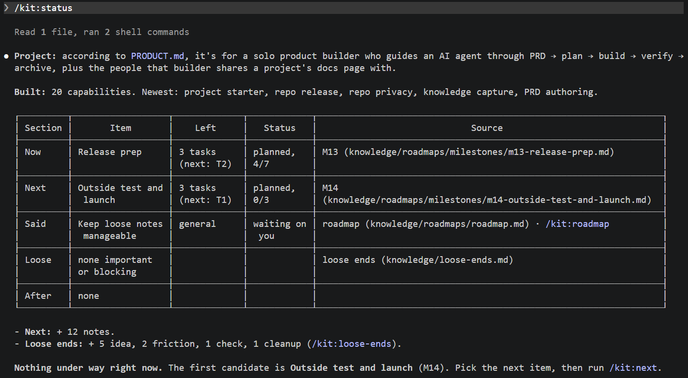

# ac-workbench

A Claude Code kit for building products. You bring ideas; it helps you and Claude turn them into a PRD, a reviewed plan and working, tested code, with the right tools set up per project.

**Who it's for:** someone who builds products with Claude Code (a product manager, a founder, a solo builder) and wants more than "just ask Claude": a written plan before the build, the open decisions asked before they're made silently, tests and reviews before anything is called done, and a record of *why* things are the way they are.

## Status

**v1 release candidate.** The kit is used daily by its author and has been run end to end on a real web app.
- Tested on **Windows** with Claude Code and Node. macOS and Linux install paths exist but haven't been run on a real machine yet.
- Built for one person per repo.
- Feedback is welcome: [open an issue](https://github.com/CKamarakis/ac-workbench/issues/new/choose).

## Quickstart

You need [Claude Code](https://code.claude.com), Node and git.

1. **Once per machine,** add the kit's marketplace (this enables nothing by itself):
   ```bash
   claude plugin marketplace add CKamarakis/ac-workbench
   ```
2. **In your project folder,** install the kit for this project only:
   ```bash
   claude plugin install kit@ac-workbench --scope project
   ```
3. **Start Claude Code there** and run:
   ```
   /kit:setup    first time on this machine: checks and installs git, gh, jq, gitleaks, OpenSpec (asks first)
   /kit:start    sets up this project: asks the project type, shows every change as a diff, writes on your yes
   /kit:next     tells you what to do next, any time
   ```

## The happy path

You can start at any step: an idea, an old PRD, a change half done. Each step knows what to take from the one before.

```
 an idea, typed or dictated
    |
    |   /kit:capture      saves it as a note in knowledge/notes/
    v
    |   /opsx:explore     think it through with Claude; the decisions and
    |                     open questions are saved as an explore record
    v
    |   /kit:prd          a PRD from your notes and that record (optional)
    v
    |   /opsx:propose     the plan: proposal, specs with Given/When/Then,
    |                     design, tasks
    v
    |   /kit:ready        the decisions the build would otherwise make alone,
    |                     asked in one batch; how careful the build should be
    |                     (worktree, review against the spec)
    v
    |   /opsx:apply       code and tests
    v
    |   /kit:verify       tests, security and code review, every scenario
    |                     mapped to a test
    v
    |   /opsx:archive     done: the specs are updated
    v
 shipped


 Any time:

    /kit:status       where the project stands: what it is, what's built,
                      what's under way, what's next

    /kit:next         the next step from where you are

    /kit:docs         your docs page: what's built, why, what's undecided

    /kit:roadmap      your roadmap: goals in order, Now, decisions waiting on you

    /kit:loose-ends   what was left behind while building, by importance
```



## Limits

- **Windows-tested only** so far (see Status).
- **Project types:** `web-ui` (web apps, with UI review and browser checks on request) and `none` (everything else). No Python or backend-specific type yet.
- **It costs tokens.** Reviews, the readiness check and docs drafting run the model. Skills are only loaded when you call them.
- **One person per repo.** Two people on one repo will get conflicts in the kit's decision records and docs page.
- **Planning runs on [OpenSpec](https://github.com/Fission-AI/OpenSpec),** which `/kit:setup` installs. The `/opsx:` commands are OpenSpec's.

## Coming next

After v1: Python and Node backend project types, mobile testing, a dashboard across projects, docs and specs drafted from an existing codebase, a suggestion for how to deploy and share your app, CI on three systems, help with notes (new, orphaned or old ones), and small teams.

---

# Reference

## Install details

The kit is installed **per project**, never for the whole machine, so it stays out of repos that aren't set up with it. The install is recorded in the project's `.claude/settings.json`. Someone who clones the project runs the same install command; until then Claude Code tells them the kit isn't installed there. `claude plugin list` shows the kit once per project it's installed in; `claude plugin list --json` names each folder (`projectPath`).

The kit loads the next time you start Claude Code in that folder (or run `/reload-plugins` in a session that's already open). Machine tools: [`docs/setup.md`](docs/setup.md).

### Update the kit

The kit's marketplace doesn't update on its own. To get a new version:

```bash
claude plugin marketplace update ac-workbench
claude plugin update kit@ac-workbench --scope project
```

Use `update`: `install` on a project that already has the kit keeps the old version. Restart Claude Code, check the version with `/kit:ping`, then run `/kit:start` to re-sync. It offers to commit the setup on its own, so it doesn't mix with your work.

### Remove the kit from a project

```bash
claude plugin uninstall kit@ac-workbench --scope project
```

`--scope project` matters: without it, the command looks at your user-level plugins, not this project's. Then remove what the kit added, if you want: the block between `kit:routing:start` and `kit:routing:end` in `CLAUDE.md`, the block between `kit:start` and `kit:end` in `.gitignore`, and `.claude/kit.json`. Your own files stay yours: `knowledge/` (notes, PRDs), `docs/project-context.md`, and `openspec/` (keep it if you keep using OpenSpec).

## What `/kit:start` does

Run it once in the project folder, and again only to re-sync after a kit update.
- On a first setup it asks **one question**: the project type (for a Next.js app it recommends `web-ui`). A re-sync reuses the saved type and says so.
- It sets up git, OpenSpec, the `CLAUDE.md` workflow rules, a project context doc, the `knowledge/` folder, and the tools for that type, all for this project only.
- Changes to files you already have are shown as diffs and need your yes.
- Heavier tools (Superpowers) are listed as **available on demand**. They're added when a change needs them, not up front.

## Skills

| Skill | What it does |
|---|---|
| `/kit:capture` | Save an idea, dictation, link or screenshot as a note |
| `/kit:prd` | Draft a PRD from your notes, update it without overwriting your edits, mark it Ready |
| `/kit:status` | Where the project stands: what's built, under way and next. Read-only |
| `/kit:next` | The next step and which skill to use |
| `/kit:explore-record` | Save what an `/opsx:explore` decided and left open |
| `/kit:loose-ends` | Things left behind while building: debt, friction, kept findings, ideas |
| `/kit:roadmap` | Optional roadmap: goals in order, Now, decisions waiting on you |
| `/kit:ready` | Before apply: ask the open decisions in one batch, pick the build safeguards. Never blocks |
| `/kit:verify` | Before archive: tests, security and code review, scenarios without a test, docs sync |
| `/kit:docs` | The project's docs page: what's built, why, what's undecided |
| `/kit:harness-review` | Read-only check-up of the project's Claude Code setup, at most three fixes |
| `/kit:setup` | Install or check the machine tools |
| `/kit:tool-review` | Monthly check of the kit's tools: update, hold or drop each one |
| `/kit:start` | Set up or re-sync a project |
| `/kit:ping` | Check that the kit is installed |

Planning and building use [OpenSpec](https://github.com/Fission-AI/OpenSpec): `/opsx:explore`, `/opsx:propose`, `/opsx:apply`, `/opsx:archive`.

## Quality gates

- **Block:** a failing required test, a missing required test command (for `web-ui`), a high-severity security finding. You can override one, with a reason that is recorded.
- **Advise:** everything else (review comments, changed files without tests, optional test suites, the docs sync, open decisions). Your call.
- **Decisions** from `/kit:ready` and the docs sync are kept per change in `decisions.md`. Open ones (including "Later") come back in `/kit:next`, `/kit:verify` and at archive, as a reminder, never a block.
- **Where they run:**
  - secrets: a gitleaks pre-commit hook;
  - tests and reviews: `/kit:verify`. A kit hook blocks `openspec archive` until the change has a passing report;
  - tests before every push: opt-in per project;
  - a **browser check** (Playwright: log in, click through the changed flows, screenshots): only when you ask, e.g. before a release. Its findings are advisory.
- **When a build or test fails on a library API,** the kit tells the agent to look up current docs (context7, no sign-in).

The hooks ship in the kit plugin and do nothing outside kit projects.

## The knowledge folder

```
 knowledge/
   notes/      one Markdown file per note (<date>-<title>.md); optional topic folders
   prds/       one PRD per file, with status and the notes it came from
   assets/     images and screenshots
   docs/       the docs page (index.html, rebuilt by /kit:docs and at archive), notes per sub-feature (<path>.md: how it works, why), tools.md
   foundations/ cards for technical choices that shape more than one sub-feature (app-wide, or <product>/)
   archive/    moved here on request; the kit never reads it
```

Plain Markdown in your repo: no external service, no quota. Notes you add by hand as `.md` are picked up as they are.

## Tools in use, and when they load

Skills load only when called. Hooks and workflow plugins act on their own, so they're kept to what each project needs.

| Tool | Installed | When it runs |
|---|---|---|
| **kit** | per project | Skills when called. Its hook acts only in kit projects: it blocks `openspec archive` until `/kit:verify` passes |
| **OpenSpec** | CLI per machine, skills per project | When you plan or build (`/opsx:…`) |
| **git, gh, gitleaks** | per machine (`/kit:setup`) | When called; gitleaks on every commit |
| **`/code-review`, `/security-review`** | built into Claude Code | From `/kit:verify`, or when you call them |
| **context7** | nothing to install | When the agent needs current library docs |
| **Impeccable** | per project, type `web-ui` | UI design checks from `/kit:prd`, `/kit:ready` and `/kit:verify`. Its hooks run on their own in that project |
| **Playwright CLI** | per project, type `web-ui` (CLI per machine) | Only when you ask for a browser check |
| **Superpowers** | on demand | When a change's safeguards choose a subagent build or test-first |

Everything else in [`toolkit.yaml`](toolkit.yaml) was evaluated and is **not in use**. Its verdict says why.

## How tools are chosen

Every tool the kit knows lives in [`toolkit.yaml`](toolkit.yaml), with:
- why it's there;
- what it costs, in money and in context;
- whether it's adopted, in trial, later or dropped;
- the evidence behind that verdict (trial notes in [`evals/trials/`](evals/trials/)).

Run `npm run registry` to validate it and print the lane map (one owning tool per workflow phase). Field reference: [`docs/registry.md`](docs/registry.md).

## Developing the kit

```bash
npm test             # unit tests
npm run evals        # eval cases for every kit skill
npm run registry     # validate toolkit.yaml, regenerate plugins/kit/data/toolkit.json
```

- **Order of work, Now and the drift log:** [`knowledge/roadmaps/`](knowledge/roadmaps/roadmap.md) (kept with `/kit:roadmap`).
- **Decisions and context:** [`docs/project-context.md`](docs/project-context.md).
- **Planned and active changes:** [`openspec/changes/`](openspec/changes/).
- **Secret scanning:** commits pass a gitleaks pre-commit hook. Enable it once per clone with `git config core.hooksPath .githooks`.

## License

MIT, see [`LICENSE`](LICENSE).
